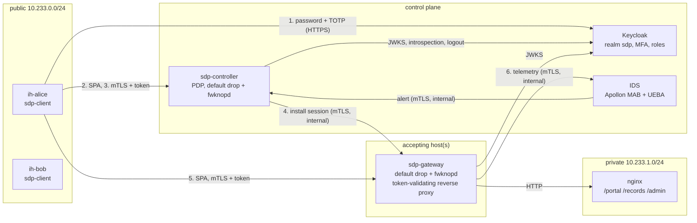

# Architecture

The paper extends the three SDP roles of the Cloud Security Alliance (controller, initiating host, accepting host) with an identity provider and an intrusion detection system, and spreads part of the verification to the hosts. This page shows how the lab implements it.

## Components and networks



| Network | Subnet | Members | Notes |
|---|---|---|---|
| `public` | 10.233.0.0/24 | IHs, controller, gateways, Keycloak | Controller and gateways drop everything on it until a valid SPA packet arrives |
| `private` | 10.233.1.0/24 | gateways, nginx | The only way to the service is through a gateway |
| `internal` | 10.233.2.0/24 | controller (`controller-mgmt`), gateways' control API, IDS, Keycloak | Management network; trusted by the firewalls of the controller and the gateways |

All three are `internal: true` Docker networks (no route to the outside, no published ports); the Compose project is called `iamidssdp`. Static addresses are used for fixed components; scaled gateways take addresses from the upper half of each subnet.

## Complete flow (paper, Sect. 5.6)

```mermaid
sequenceDiagram
  autonumber
  actor U as User
  participant IH as Initiating host (sdp-client)
  participant KC as Keycloak (IAM)
  participant C as SDP controller
  participant AH as Accepting host (sdp-gateway)
  participant S as Protected service
  participant IDS as IDS (MAB + UEBA)

  U->>IH: password + TOTP code
  IH->>KC: token request (direct grant, password + totp)
  KC-->>IH: access token (sub, sid, realm roles, aud sdp-controller/sdp-gateway, 5 min)
  IH->>C: SPA packet (static device keys)
  Note over C: fwknopd opens tcp/8443 for the IH address (5 s)
  IH->>C: mTLS (device certificate) POST /v1/sessions {service} + Bearer token
  C->>C: verify token: JWKS signature, iss, aud, exp, azp
  C->>KC: token introspection (still active?)
  C->>C: device owned by the token's user? roles grant the service? (RBAC)
  C->>AH: mTLS (internal) install session: per-session SPA keys, IH address, identity, roles
  AH->>AH: fwknopd stanza for this session only
  C-->>IH: session id, AH addresses, per-session SPA keys
  IH->>AH: SPA packet (per-session keys)
  Note over AH: fwknopd opens tcp/8443 for the IH address
  loop every request
    IH->>AH: mTLS (device certificate) GET /portal/ + Bearer token
    AH->>AH: verify token (JWKS), session of this address/device/user, roles grant the path
    AH->>S: forwarded request (identity headers, no token)
    S-->>AH: response
    AH-->>IH: response
  end
  AH->>IDS: per-session features every 2 s (mTLS, internal)
  IDS->>IDS: Thompson-sampled classifier + baseline of the user
  alt anomalous for 2 consecutive windows
    IDS->>C: alert (session, user, reason)
    C->>AH: revoke session: remove stanza, firewall rules, connections; refuse token sid
    C->>KC: log the user out (all SSO sessions)
    C->>C: audit log: ids_alert, session_revoked, gateway_revoke, iam_logout
  end
```

The six stages of the paper map to the lab as follows:

| Paper stage | Where it happens |
|---|---|
| 1. Initial authentication with IAM (MFA, RBAC, session token) | `sdp-client` → Keycloak direct grant with `totp`; roles in `realm_access.roles` |
| 2. mTLS tunnel to the controller, token included, token and key pair both validated | `internal/controller` (`handleCreateSession`), `internal/iam` (`Validator`, introspection) |
| 3. Authorization and policy enforcement | `internal/policy` (`AuthorizeProposed`: device owner + roles → service) |
| 4. Communication with the AH, which verifies credentials and permissions itself | `internal/gateway` (`Install`, `authorize`: own JWKS validation and RBAC copy) |
| 5. Threat detection and response | `ids/` (detector) → controller `POST /v1/alerts` → `endSessions` |
| 6. Session termination and logging | `DELETE /v1/sessions/{id}`, expiry, revocation; JSON-lines audit logs of the controller and every AH |

## Traditional vs proposed mode

| | Traditional | Proposed |
|---|---|---|
| IH credential to the controller | device key pair (mTLS) + device SPA keys | the same **and** a Keycloak access token obtained with password + TOTP |
| Authorization | device registry: services listed for the device | device registry **and** the token's user must own the device **and** a realm role must grant the service |
| Accepting host | trusts the controller's session (address + device certificate) | also validates the token itself (signature, issuer, audience, expiry), its session id, and the roles for the requested path |
| Monitoring | none | per-session telemetry to the IDS; alerts revoke sessions |
| Revocation | session end or expiry | also on IDS alert or administrator action, including the user's Keycloak sessions |

Both modes share the PKI, SPA (fwknop), the default-drop firewalls, per-session SPA keys and the audit trail, so the benchmark compares the cost of the IAM and IDS additions only.

## Decentralised checks

The paper argues that the accepting host should not trust the controller blindly (§5.5). In the lab the AH:

- downloads Keycloak's signing keys and validates every bearer token (audience `sdp-gateway`), caching a successful validation until the token expires;
- requires the request to come from the address and device certificate of a session the controller installed, and the token's subject to be the session's user;
- re-applies the role → service mapping from its own copy of `config/policy.yaml`;
- refuses tokens whose Keycloak session id (`sid`) belongs to a revoked session, even before they expire.

A compromised controller can therefore install a session, but it cannot make the AH serve a path to a user whose token lacks the role.

## State and failure behaviour

- Sessions live in the controller's memory. On restart it gets a new instance id; each gateway notices it at its next registration (every 10 s) and drops every session granted by the previous instance.
- Gateways register every 10 s; the controller forgets gateways not heard from for 45 s, and a gateway deregisters on shutdown.
- Sessions last at most 5 minutes (`SDP_SESSION_TTL`) and never longer than the access token.
- If the IDS cannot reach the controller, the alert is retried on the next anomalous window.
