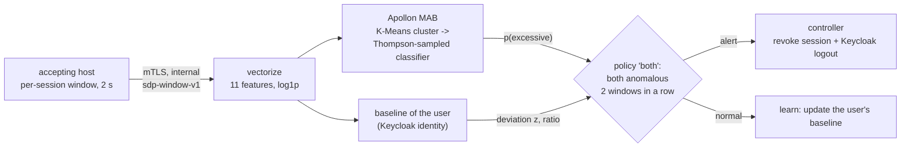

# IDS & UEBA

The paper integrates **Apollon**, the authors' IDS, with the SDP controller and feeds it with identity context from the IAM, so that the combination behaves like User and Entity Behaviour Analytics (UEBA) without a separate product (Sect. 2.5–2.6, 5.3). This page explains what the lab's IDS does, what its model is and is not, and how to plug in a real Apollon model.

## Pipeline



1. Every accepting host summarises each session's traffic in 2-second windows (request rate, request and response byte rates, error ratio, latency, new and open connections, connections without a complete request, inter-arrival time mean and variability, distinct paths) and posts them, with the session's Keycloak identity, to the IDS over mutual TLS.
2. **Classifier pool (Apollon).** The window is assigned to a K-Means cluster; for that cluster a Beta posterior per classifier tracks how often it has been right, and Thompson sampling picks the classifier that answers this window. The pool is the classifier families of the Apollon paper: random forest, decision tree, Gaussian naive Bayes, logistic regression and a small MLP. The code is Apollon's `ApollonMAB` (Apache-2.0), vendored in `ids/sdp_ids/apollon_mab.py` with credit and a list of changes in `ids/third_party/apollon/NOTICE`.
3. **Per-identity baseline (UEBA).** For each Keycloak user the IDS keeps an exponentially weighted mean and variance of the request rate and of the response byte rate, in log space, starting from a population prior learnt from the normal windows of the training data. A window deviates when a feature is at least 4 standard deviations **and** 5 times above the user's typical value. Only increases count, and windows flagged by either detector are not learnt, so a burst cannot become the new normal.
4. **Decision.** With the default policy `both`, a window is anomalous when the Thompson-sampled classifier and the baseline agree; two anomalous windows in a row for the same session raise one alert. The alert goes to the controller, which revokes the session (and, by default, the user's other sessions) on every AH and logs the user out of Keycloak.

Requiring both detectors keeps a heavy but habitual user (e.g. an application that always polls fast) from being cut off by the classifier alone, and keeps a light user's unusual-but-modest activity from being cut off by the baseline alone. Other policies (`either`, `classifier`, `ueba`) are available through `IDS_POLICY`.

## What the lab model is

!!! warning "A demonstration model, not a production detector"
    The lab model is trained, while the IDS image is built, on **telemetry windows recorded in this lab** from **ordinary, benign workloads at different intensities** (`ids/data/lab-windows.csv`, produced by `scripts/ids/record-dataset.sh`). It learns one distinction: **application-paced usage** versus **saturating, machine-paced volume** on a session. It was never trained on attack traffic and has no notion of exploits, scans, credential misuse or adversarial examples.

How the dataset is produced (`scripts/ids/record-dataset.sh`): five benchmark initiating hosts of the user `bench` run workloads against the portal through two accepting hosts while the IDS records every window it receives (with enforcement off). Each workload runs in its own SDP session, and only windows that fall entirely within the workload are kept and labelled with its class:

| Class | Profiles (each 40 s, two repetitions) | Tool |
|---|---|---|
| 0, application-paced | browsing with 2 s, 1 s (3 workers) and 0.5 s think times; API polling at 5, 10 and 20 requests/s; downloading a 256 KiB file every 1 s and every 0.25 s | `sdp-client load` (closed loop with think time) |
| 1, excessive volume | closed-loop load tests with 1, 2, 5, 10 and 25 concurrent workers, a rate-limited run (5 workers × 20 requests/s) and concurrent downloads | `hey`, the standard HTTP load generator, through the session's local forwarder |

The committed dataset (recorded on 2026-11-13) has **1470 windows: 918 of class 0 and 552 of class 1**. Per accepting host and window, class 0 ranges from 0.5 to 10 requests/s (up to 0.5 MB/s for downloads) and class 1 from 35 to about 2350 requests/s:

| Profile | Class | Windows | Requests/s per AH (median) |
|---|---|---|---|
| browse-slow / browse / browse-multi | 0 | 77 / 152 / 77 | 0.5 / 1.0 / 1.5 |
| poll-5 / poll-10 / poll-20 / poll-10x2 | 0 | 153 / 154 / 77 / 76 | 2.5 / 5.0 / 10.0 / 10.0 |
| download / download-fast (256 KiB) | 0 | 76 / 76 | 0.5 / 2.0 |
| hey-q100 (rate limited) | 1 | 79 | 50 |
| hey-download | 1 | 79 | 91 |
| hey-c1 / c2 / c5 / c10 / c25 | 1 | 79 / 79 / 80 / 78 / 78 | 82 / 1215 / 465 / 661 / 725 |

Hold-out evaluation (25 % stratified split, seed 7), printed by `python -m sdp_ids.train` and stored in the image as `/opt/ids/model.json`. These are **local measurements on the committed dataset**:

| Metric | Value |
|---|---|
| Hold-out windows | 368 (230 class 0, 138 class 1) |
| Accuracy of the MAB (Thompson-sampled arm per window) | 1.000 |
| True / false positive rate | 1.000 / 0.000 |
| Accuracy of each arm alone (RF, DT, NB, LR, MLP) | 1.000 each |
| Share of windows answered by each arm | RF 21 %, DT 21 %, NB 10 %, LR 22 %, MLP 26 % |

These figures say that the two classes of this dataset are easy to separate (the gap between the busiest normal profile and the lightest load test is large); they say nothing about real attacks. Because requests are spread over two AHs, per-AH rates are half the per-session rates.

What it is not:

- It is **not** the Apollon model of the Apollon paper, which was trained on network-flow features (CICFlowMeter) of public intrusion datasets. The lab's features are per-session HTTP statistics computed by the accepting host.
- It does **not** reproduce the detection rates or the adversarial robustness reported in the Apollon paper or quoted in this paper.
- It sees one session on one AH at a time; it does not correlate across AHs or users beyond the per-user baseline.
- Its MAB posteriors are initialised on the validation split and are not updated at run time (no analyst feedback loop is wired, although `ApollonMAB.update` supports it).

## Plugging in a real Apollon model

The IDS loads `IDS_MODEL` (default `/opt/ids/model.joblib`). Two formats are accepted:

1. **`sdp-ids-model/v1`** (what `python -m sdp_ids.train` writes): a joblib dict with the estimator, an optional `StandardScaler`, the UEBA prior and metadata. Train on your own labelled windows:

    ```bash
    cd ids
    python -m sdp_ids.train --data my-windows.csv --out my-model.joblib --report my-model.json
    ```

    The CSV needs the columns `profile,label,gateway,window_secs` and the 11 feature columns (see `ids/sdp_ids/dataset.py`). Record windows from your own traffic with `IDS_RECORD_PATH=/data/raw.csv IDS_ENFORCE=0 docker compose up -d ids` and label them with `python -m sdp_ids.dataset label`.

2. **A bare estimator pickled with the Apollon repository.** Fit `MAB.apollon_mab.ApollonMAB` from [antoniopaya22/apollon](https://github.com/antoniopaya22/apollon) on `sdp_ids.features.vectorize` output (the 11 `sdp-window-v1` features after `log1p`, in that order) and pickle it. The loader maps Apollon's module path `MAB.apollon_mab` to the vendored copy, so the pickle loads without the Apollon repository installed; without a prior in the file the baseline uses a built-in default prior.

Mount the file and point the IDS at it:

```yaml
# docker-compose.override.yml
services:
  ids:
    environment:
      IDS_MODEL: /models/apollon.pkl
    volumes:
      - ./models:/models:ro
```

A model trained by Apollon on CIC flow features **cannot** be used directly: the accepting hosts would have to export the same flow features (e.g. by running a flow meter on their public interface) and `ids/sdp_ids/features.py` would have to describe them. That is the main piece of work needed to run the paper's actual detector inside this SDP.

## Operating the IDS

```text
$ docker compose exec ids python -m sdp_ids status
policy both (x2 windows), enforce True: 412 windows, 2 anomalous, 1 alerts
model arms ['RandomForestClassifier', 'DecisionTreeClassifier', 'GaussianNB', 'LogisticRegression', 'MLPClassifier']; hold-out accuracy 1.0 (TPR 1.0, FPR 0.0)
baseline alice: 1.411 req/s typical, 424 B/s out, 13 windows learnt
alert 2026-11-13T11:17:43Z session f100... (alice): req_rate 3947.2/s is 2798x the baseline of alice (1.4/s, z=13.1); classifier LogisticRegression (Thompson-sampled) p=1.00; 2 consecutive windows -> controller {'action': 'revoked', ...}
```

`--json` adds the most recent decisions (probability, selected classifier, baseline z-score and ratio). Baselines live in memory and restart empty (from the prior) when the container is recreated.
